# MayaDesk (Ultra-Lightweight Multi-Disk Private Cloud & High-Throughput NAS Engine)

[English](README.md) | [简体中文](README_zh.md)

[](LICENSE)
[](https://www.rust-lang.org/)
[](https://github.com/tokio-rs/axum)
[](https://www.solidjs.com/)
[](https://v2.tauri.app/)
[](https://www.docker.com/)
[]()

**MayaDesk** is an ultra-lightweight, high-performance private cloud storage and NAS aggregation platform engineered with a strict **P2P direct-first transmission topology, zero-trust Cloudflare Tunnel fallback, and a minimalist flat reactive frontend**. Built on a native **Rust (`Axum` + `SQLx SQLite WAL` + `WebRTC DataChannel`)** core and a **SolidJS + Tailwind CSS v4** UI, MayaDesk eliminates external gateway dependencies, public IP exposure, and heavyweight runtime overhead.

Designed for personal homelabs, multi-disk DIY NAS servers, and distributed collaborative teams, MayaDesk delivers seamless multi-disk physical pooling (aggregating NVMe SSDs, SATA RAID arrays, and external mount points into logically isolated private user vaults and shared group disks). It pairs zero-exposure out-of-the-box remote access with line-rate local peer-to-peer transfers, sub-15KB client bundles, instant in-browser media/document previews, and native cross-platform desktop integration via **Tauri v2**.

---

## Table of Contents

- [System Architecture & Data Topology](#system-architecture--data-topology)
- [Core Subsystems Reference](#core-subsystems-reference)
  - [1. Multi-Disk Storage Pooling & Virtual File System (VFS)](#1-multi-disk-storage-pooling--virtual-file-system-vfs)
  - [2. Dual-Channel High-Throughput Transport: WebRTC P2P Direct & Cloudflare Tunnel Fallback](#2-dual-channel-high-throughput-transport-webrtc-p2p-direct--cloudflare-tunnel-fallback)
  - [3. Ultra-Lightweight Monolithic Reactive Web Client (SolidJS + Tailwind CSS v4, ~13KB gzip)](#3-ultra-lightweight-monolithic-reactive-web-client-solidjs--tailwind-css-v4-13kb-gzip)
  - [4. Cross-Platform Desktop & Mobile Client Architecture (Tauri v2)](#4-cross-platform-desktop--mobile-client-architecture-tauri-v2)
  - [5. macOS Native Integration (HiddenInset Titlebar, MenuBar Tray, Keychain, & WebDAV)](#5-macos-native-integration-hiddeninset-titlebar-menubar-tray-keychain--webdav)
  - [6. Dual-Mode Identity & Fine-Grained RBAC Engine (Argon2id + Google OAuth2 + Guest Access)](#6-dual-mode-identity--fine-grained-rbac-engine-argon2id--google-oauth2--guest-access)
  - [7. In-Browser Multi-Format High-Performance Preview & Remote Extraction](#7-in-browser-multi-format-high-performance-preview--remote-extraction)
  - [8. 100% Dynamic Path & Hot-Reload Configuration Engine (TOML + Web Config Panel)](#8-100-dynamic-path--hot-reload-configuration-engine-toml--web-config-panel)
  - [9. Zero-Public-Port Containerized Deployment (Docker Compose + Ingress Profiles)](#9-zero-public-port-containerized-deployment-docker-compose--ingress-profiles)
- [Auxiliary Engineering Documentation](#auxiliary-engineering-documentation)
- [Quick Start & Deployment Guide](#quick-start--deployment-guide)
  - [1. Deploying with Docker Compose (Recommended)](#1-deploying-with-docker-compose-recommended)
  - [2. Enabling Cloudflare Zero Trust Tunnel (Zero Public IP Exposure)](#2-enabling-cloudflare-zero-trust-tunnel-zero-public-ip-exposure)
  - [3. Building and Running from Source](#3-building-and-running-from-source)
- [Repository Structure](#repository-structure)
- [Roadmap & Milestones](#roadmap--milestones)
- [License](#license)

---

## System Architecture & Data Topology

MayaDesk decouples the signaling and control plane from the high-performance data path using an automated Happy Eyeballs racing state machine:

```mermaid
flowchart TB
    subgraph Clients ["Client Tier (Zero-Overhead Endpoints)"]
        Web["Web Browser (SolidJS SPA, ~13KB gzip)"]
        Mac["macOS Native Client (Tauri v2 + WKWebView)"]
        WinLin["Windows / Linux Desktop Client"]
        Mobile["Android Mobile Client"]
    end

    subgraph Ingress ["Ingress & Discovery Tier"]
        CFTunnel["Cloudflare Zero Trust Outbound Tunnel (No open ports)"]
        STUN["STUN Reflection Cluster (Cloudflare / Google STUN)"]
        mDNS["Local mDNS / Broadcast Discovery"]
    end

    subgraph ChannelRace ["Happy Eyeballs Dual-Channel Racing (1500ms Window)"]
        direction TB
        Probe{"P2P Direct Probe\n(ICE Candidate Exchange)"}
        P2PChannel["WebRTC DataChannel / QUIC\n(LAN wire-speed / WAN Direct Hole Punch)"]
        TunnelChannel["Cloudflare Tunnel HTTPS/WSS Fallback\n(HTTP/2 & HTTP/3 Range Stream)"]
        Probe -->|Hole-Punch Success / LAN Direct| P2PChannel
        Probe -->|Symmetric NAT / Firewall Block| TunnelChannel
    end

    subgraph CoreServer ["MayaDesk Core Server (Rust Axum + Tokio)"]
        Signaling["WebSocket Signaling Gateway (/api/v1/p2p/ws)"]
        AuthModule["Dual-Mode Auth Engine (Argon2id + Google OAuth2 + JWT)"]
        VFS["Multi-Disk Virtual File System (VFS RBAC & Path Normalization)"]
        ConfigEngine["Dynamic Hot-Reload Engine (TOML + Web API)"]
        PreviewEngine["Stream Media Slicing & Archive Extraction"]
        Blake3Engine["BLAKE3 Zero-Copy Parallel SIMD Checksum"]
    end

    subgraph Storage ["Underlying Multi-Disk Physical Storage Layer"]
        SQLite[("SQLite WAL Concurrent Database\n(mayadesk.db)")]
        PrivateNVMe[("Private Space NVMe Disk\n(/mnt/nvme0/<user_id>)")]
        SharedHDD1[("Shared Disk 1: Media & Archives\n(/mnt/raid_storage)")]
        SharedHDD2[("Shared Disk 2: Team Collaboration\n(/mnt/work_drive)")]
    end

    Clients --> Ingress
    Ingress --> ChannelRace
    ChannelRace --> CoreServer
    CoreServer --> Storage
```



---

## Core Subsystems Reference

### 1. Multi-Disk Storage Pooling & Virtual File System (VFS)
- **Physical Isolation with Unified Logical Hierarchy**: Unifies disparate host storage media (NVMe SSDs, SATA RAID volumes, USB drives, ZFS datasets) under a unified virtual filesystem hierarchy without rigid single-root constraints.
- **Physical Vault Isolation for Private Storage**: User personal assets are strictly persisted to dedicated physical subpaths (`<private_mount>/<user_id>`). Enforced at both the filesystem permission boundary and cryptographic JWT session layer.
- **Role-Based Shared Disk Pools**: Mounts unlimited shared disks (e.g., `/mnt/shared1`, `/mnt/shared2`) with granular role bindings (read-only vs. read-write access) manageable directly from the Web interface.
- **BLAKE3 Hardware-Accelerated Integrity**: Employs the `blake3` 256-bit cryptographic tree hash algorithm. Exploits SIMD vectorization (AVX-512, AVX2, ARM NEON) to deliver **>2.5 GB/s** single-core chunk hashing throughput for deduplication and corruption verification.

### 2. Dual-Channel High-Throughput Transport: WebRTC P2P Direct & Cloudflare Tunnel Fallback
- **1500ms Happy Eyeballs Racing Protocol**: Upon establishing a session, client and server negotiate SDP Offer/Answer and exchange ICE candidates (local host addresses and srflx STUN addresses) via WebSocket. If the `mayadesk-vfs-blocks` DataChannel establishes within 1500ms, data streams upgrade to end-to-end P2P.
- **Line-Rate Local Area Network (LAN) Transfers**: Bypasses WAN uplinks and external relays entirely when on the same LAN, saturating Gigabit, 2.5G, and 10G physical interfaces.
- **Wide Area Network (WAN) STUN Hole-Punching**: Integrated multi-vendor STUN probes (Cloudflare and Google STUN) facilitate peer-to-peer traversal across Full Cone and Restricted Cone NAT typologies.
- **Seamless Zero-Trust Relay Fallback**: If trapped behind strict Symmetric NAT or enterprise firewalls, transfers seamlessly step down to Cloudflare Tunnel HTTPS/2 and HTTP/3 chunked range streams, ensuring 100% universal reachability.

### 3. Ultra-Lightweight Monolithic Reactive Web Client (SolidJS + Tailwind CSS v4, ~13KB gzip)
- **Zero-Virtual-DOM Reactive Architecture**: Powered by SolidJS granular fine-grained reactive primitives (Signals). The production build compresses to just **~13 KB gzip**, yielding instantaneous cold starts and negligible client memory usage.
- **Minimalist Flat Light-Blue & Monochrome Aesthetic**: Strictly maintains pure white backgrounds (`#FFFFFF`), solid razor-thin black borders (`#000000`), and soft blue interactive highlights (`#E0F2FE` / `#BAE6FD`). Eliminates excessive blur effects and heavy box shadows.
- **Resizable Multi-Column Grid**: Features smooth mouse-draggable column resizing (Name, Size, Modified Date, Type) with interactive directional sorting.
- **Reactive Hierarchical Tree Navigation**: The collapsible directory tree smoothly animates transitions and reacts instantly to remote server-side filesystem updates.

### 4. Cross-Platform Desktop & Mobile Client Architecture (Tauri v2)
- **Native OS Web Engine Reuse**: Built on the Tauri v2 framework, completely eschewing Electron's multi-hundred-megabyte bundled Chromium engine in favor of the host OS Web engine (`WKWebView` on macOS, `WebView2` on Windows, `WebKitGTK` on Linux).
- **Minimal Distribution Footprint**: Distribution installers are between **4.5 MB and 7.5 MB** (representing an over 95% reduction compared to Electron alternatives).
- **Ultra-Low Memory Consumption**: Idle background tray daemon uses **< 25 MB RAM**, while the active foreground workspace window consumes **< 65 MB RAM**.

### 5. macOS Native Integration (HiddenInset Titlebar, MenuBar Tray, Keychain, & WebDAV)
- **HiddenInset Title Bar**: Implements macOS native frameless styling with traffic-light inset alignment compliant with macOS Sonoma and Sequoia human interface guidelines.
- **Persistent Menu Bar Status Item (`NSStatusItem`)**: Minimizes to the menu bar tray upon closing the main window, showing real-time sync metrics, quick-access popovers, and network status indicators.
- **Secure Token Persistence via Apple Keychain**: Session JWTs and authentication tokens are encrypted and managed directly via the macOS Keychain Services API.
- **Zero-KEXT Native Finder Network Drive**: Features an internal loopback WebDAV bridge (`127.0.0.1:18085`), enabling seamless mounting as `/Volumes/MayaDesk` in Finder without disabling SIP or installing third-party kernel extensions.

### 6. Dual-Mode Identity & Fine-Grained RBAC Engine (Argon2id + Google OAuth2 + Guest Access)
- **Argon2id Password Protection**: Local account passwords are salted and hashed using the memory-hard **Argon2id** algorithm, resilient against GPU-accelerated dictionary attacks.
- **Google OAuth 2.0 (OIDC)**: Native single sign-on integration verifies Google user identities and automatically binds them to internal accounts.
- **Three-Tier Role-Based Access Control (RBAC)**:
  - **Admin**: Complete system oversight, dynamic physical path updates, storage pool mount control, and user management.
  - **Member**: Unrestricted read/write access to isolated private storage and assigned shared disks.
  - **Guest**: Default unauthenticated state offering restricted read-only preview access to public shared disks.

### 7. In-Browser Multi-Format High-Performance Preview & Remote Extraction
- **Code & Plaintext Viewer**: Syntax highlighting and line numbering for `.rs`, `.ts`, `.tsx`, `.js`, `.py`, `.json`, `.toml`, `.yaml`, `.md`, `.txt`, `.sql`, and more.
- **Interactive PDF Canvas**: Embedded lightweight PDF rendering with fluid page flipping and zoom controls.
- **Responsive Image Lightbox**: High-resolution viewport-aware viewing for WebP, PNG, JPEG, and SVG.
- **HTML5 Video Player with HTTP 206 Range Seeking**: Native video player supporting `.mp4`, `.webm`, and `.mov` with byte-range headers (`Accept-Ranges: bytes`) for smooth instant scrubbing.
- **Server-Side Archive Extraction**: Triggers server-side uncompressed streaming extraction for `.zip` and `.tar.gz` archives directly on the host storage disk without requiring local round-trip downloads.

### 8. 100% Dynamic Path & Hot-Reload Configuration Engine (TOML + Web Config Panel)
- **Centralized TOML Architecture**: Configuration converges cleanly inside [`config/config.toml`](config/config.toml).
- **Online Visual Mount Administration**: Administrators can view physical host disk paths, dynamically add or detach shared pools, and write adjustments directly back to disk via `PUT /api/v1/config`.
- **Self-Healing Path Verification**: Automatically creates and verifies directories for database storage, upload chunk staging, and logging upon startup or reconfiguration.

### 9. Zero-Public-Port Containerized Deployment (Docker Compose + Ingress Profiles)
- **Outbound-Only Tunneling**: Through an isolated `cloudflared` container, MayaDesk maintains an outbound secure tunnel to Cloudflare Edge. No public IPv4, DDNS, or open router ports are required.
- **Flexible Profile Orchestration**: Supports self-contained local network deployments or instant Zero Trust secure perimeter enablement via `--profile tunnel`.

---

## Auxiliary Engineering Documentation

Detailed engineering specifications, protocol definitions, and developer blueprints are organized in [`docs/`](docs/):

| Document | Focus Area | Core Content |
| :--- | :--- | :--- |
| [**System Architecture & Module Design**](docs/ARCHITECTURE.md) | High-Level Architecture | Monorepo layout, layered abstraction models, data routing paths, and technology stack. |
| [**P2P Hole Punching & Tunnel Fallback Protocol**](docs/P2P_AND_TUNNEL_PROTOCOL.md) | Transport Protocols | Happy Eyeballs state machine, WebRTC DataChannel signaling, and chunk transfer framing. |
| [**Storage Pooling & Dual-Mode Auth Spec**](docs/STORAGE_AND_AUTH_SPEC.md) | Storage & Security | VFS physical path mapping, Argon2id & OAuth2 flows, and BLAKE3 verification models. |
| [**macOS Native Client Architecture**](docs/MACOS_CLIENT_DESIGN.md) | Desktop Client | WKWebView optimization, MenuBar daemon, Apple Keychain integration, and WebDAV bridge. |
| [**Implementation Roadmap & Milestones**](docs/ROADMAP.md) | Project Governance | Phase-by-phase delivery criteria, acceptance metrics, and feature evolution targets. |

---

## Quick Start & Deployment Guide

### Prerequisites
- **Operating System**: Linux (Debian, Ubuntu, Arch), macOS (Apple Silicon / Intel), Windows 11
- **Container Engine (Recommended)**: Docker 24.0+ & Docker Compose v2
- **Development Toolchain (For Source Builds)**:
  - Rust 1.83.0+ (`cargo`)
  - Node.js 22+ (`npm` or `pnpm`)

---

### 1. Deploying with Docker Compose (Recommended)

#### Step 1: Configure Environment & Storage Mount Points
```bash
git clone https://github.com/TianYaYou/MayaDesk.git
cd MayaDesk/deploy
cp .env.example .env
```

Modify `deploy/.env` to configure your server port, persistent data directory, and the physical mount points of your NAS drives:
```dotenv
SERVER_PORT=8080
PUBLIC_URL=http://localhost:8080

# Host storage and physical drive mapping paths
HOST_DATA_DIR=/data/mayadesk_appdata
HOST_PRIVATE_DISK_PATH=/mnt/nvme0/private_storage
HOST_SHARED_DISK1_PATH=/mnt/raid_storage/shared1
HOST_SHARED_DISK2_PATH=/mnt/work_drive/shared2
```

#### Step 2: Build and Launch Containers
```bash
docker compose up -d --build
```

#### Step 3: Access the MayaDesk Dashboard
Navigate to `http://<SERVER_IP>:8080` in your browser:
- **Default Admin Email**: `admin@mayadesk.local`
- **Default Admin Password**: `admin123456`
> *Security Notice: Change the default password and configure a custom JWT secret in `config/config.toml` or the Web Settings panel upon initial login.*

---

### 2. Enabling Cloudflare Zero Trust Tunnel (Zero Public IP Exposure)

If your NAS is located behind CGNAT or lacks a public IP, obtain a free tunnel token from the [Cloudflare Zero Trust Dashboard](https://one.dash.cloudflare.com/) and paste it into `deploy/.env`:

```dotenv
CF_TUNNEL_TOKEN=eyJhIjoiY2...your_cloudflare_tunnel_token...
```

Start the stack with the `tunnel` profile enabled:
```bash
docker compose --profile tunnel up -d --build
```
Your NAS is now securely accessible worldwide through your configured domain with zero router port forwarding required!

---

### 3. Building and Running from Source

#### Run the Rust Backend Server
```bash
# Starts the Axum backend and auto-migrates SQLite WAL
cargo run --package mayadesk-server
```
The server listens on `0.0.0.0:8080` and loads settings from `../config/config.toml`.

#### Run the SolidJS Frontend Development Server
```bash
cd frontend
npm install
npm run dev
```
The Vite development server will start at `http://localhost:5173`, proxying API and WebSocket traffic automatically to port `8080`.

#### Run the Desktop Client (Tauri v2)
```bash
cd desktop/src-tauri
cargo tauri dev
```

---

## Repository Structure

```text
MayaDesk/
├── .github/                              # Community governance & CI workflows
│   ├── ISSUE_TEMPLATE/
│   │   ├── bug_report.md                 # Structured issue template for bugs
│   │   └── feature_request.md            # Feature proposal template
│   ├── workflows/
│   │   └── ci.yml                        # GitHub Actions automated backend & frontend CI
│   └── pull_request_template.md          # Standardized PR checklist
├── backend/                              # [Backend Engine] Rust (Axum 0.7 + SQLx SQLite WAL + WebRTC)
│   ├── migrations/
│   │   └── 0001_initial_schema.sql       # Initial database migration (Users, Sessions, VFS Nodes)
│   ├── src/
│   │   ├── main.rs                       # Server entrypoint and graceful shutdown lifecycle
│   │   ├── config.rs                     # Dynamic config parsing, validation, and self-healing paths
│   │   ├── api/                          # RESTful endpoints and WebSocket signaling routes
│   │   │   ├── auth.rs                   # Authentication, session refresh, and Google OAuth2
│   │   │   ├── config.rs                 # Live physical mount and system settings management
│   │   │   ├── vfs.rs                    # Directory browsing, chunk upload/download, media streaming
│   │   │   └── ws.rs                     # P2P ICE candidate & SDP signaling exchange
│   │   ├── auth/                         # Argon2id hashing, JWT token lifecycle & RBAC guards
│   │   ├── db/                           # Async SQLite WAL connection pool & metadata indices
│   │   ├── p2p/                          # WebRTC connection state machine & peer coordination
│   │   ├── tunnel/                       # Cloudflare Tunnel status inspection & fallback routing
│   │   └── vfs/                          # Multi-disk physical path mapping & BLAKE3 integrity verification
│   ├── .env.example                      # Backend environment variable template
│   └── Cargo.toml                        # Backend crate manifest
├── frontend/                             # [Frontend Application] SolidJS + Tailwind CSS v4 Flat Workspace
│   ├── src/
│   │   ├── App.tsx                       # Core storage workspace view (Resizable columns, tree, modals)
│   │   ├── main.tsx                      # SolidJS DOM bootstrap
│   │   ├── index.css                     # Tailwind CSS v4 design tokens and color definitions
│   │   └── services/
│   │       ├── authService.ts            # Dual-mode authentication & silent JWT refresh
│   │       └── p2pTransport.ts           # 1500ms Happy Eyeballs racing & P2P / Tunnel transport
│   ├── index.html                        # Application HTML shell
│   ├── vite.config.ts                    # Vite 6 build configuration & reverse proxy rules
│   ├── tsconfig.json                     # Strict TypeScript configuration
│   ├── .env.example                      # Frontend environment variable template
│   └── package.json                      # Lightweight dependencies (No Virtual DOM overhead)
├── desktop/                              # [Desktop Client] Tauri v2 shell (macOS / Windows / Linux / Android)
│   └── src-tauri/
│       ├── src/
│       │   ├── lib.rs                    # Cross-platform client core & native BLAKE3 commands
│       │   └── main.rs                   # Desktop entrypoint
│       ├── Cargo.toml                    # Desktop crate dependencies
│       └── tauri.conf.json               # Frameless window, MenuBar tray & multi-target build configs
├── config/                               # [Configuration Layer]
│   └── config.toml                       # Global configuration (Ports, DB path, Mount points, STUN, Tunnel)
├── deploy/                               # [Production Deployment]
│   ├── Dockerfile.backend                # Full-stack multi-stage Docker build recipe
│   ├── docker-compose.yml                # Server and optional cloudflared service orchestration
│   ├── .env.example                      # Host directory and environment variable template
│   └── cloudflared/
│       └── config.yml                    # Cloudflare Zero Trust Ingress routing configuration
├── docs/                                 # [Engineering Whitepapers & Specifications]
│   ├── ARCHITECTURE.md                   # System architecture and Monorepo decoupling specifications
│   ├── P2P_AND_TUNNEL_PROTOCOL.md        # P2P hole-punching and Cloudflare Tunnel fallback protocol
│   ├── STORAGE_AND_AUTH_SPEC.md          # Multi-disk storage pooling & dual-mode auth specifications
│   ├── MACOS_CLIENT_DESIGN.md            # macOS native lightweight client architecture blueprint
│   └── ROADMAP.md                        # Phased evolution roadmap and acceptance criteria
├── Cargo.toml                            # Cargo Workspace root manifest
├── Cargo.lock                            # Dependency version lockfile
├── LICENSE                               # MIT Open Source License
├── README.md                             # English project documentation and overview
└── README_zh.md                          # Simplified Chinese project documentation and overview
```

---

## Roadmap & Milestones

- [x] **Phase 1: Core Foundation & Multi-Disk VFS**: Rust Axum backend, SQLite WAL migrations, physical path isolation, and BLAKE3 checksums.
- [x] **Phase 2: Ultra-Lightweight Flat UI & Full File Suite**: SolidJS + Tailwind v4 workspace, draggable resizable column layout, in-browser previews (Code, PDF, Image, Video Range Seek), and server-side archive extraction.
- [x] **Phase 3: Dual-Mode Identity & Dynamic Hot-Reload**: Argon2id password hashing, Google OAuth2 SSO, Web physical path manager, and instant TOML persistence.
- [ ] **Phase 4: Native Desktop Client & Finder Integration**: Tauri v2 macOS native client (HiddenInset title bar, MenuBar status item, Apple Keychain token security, and local loopback WebDAV Finder mount).
- [ ] **Phase 5: Automated Mobile Backup**: Android background incremental media backup over local Wi-Fi or P2P direct connection.

---

## License

This project is licensed under the **MIT License**. See the [LICENSE](LICENSE) file for details.
