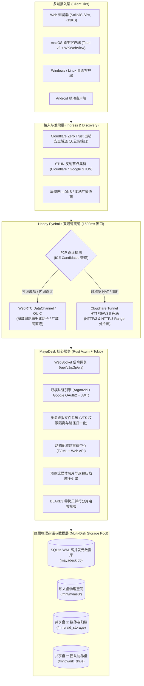

# MayaDesk (P2P 优先与 Cloudflare Tunnel 兜底的多盘 NAS 极轻量私有云)

[English](README.md) | [简体中文](README_zh.md)

[](LICENSE)
[](https://www.rust-lang.org/)
[](https://github.com/tokio-rs/axum)
[](https://www.solidjs.com/)
[](https://v2.tauri.app/)
[](https://www.docker.com/)
[]()

**MayaDesk** 是一款专为个人 HomeLab、多硬盘 DIY NAS 以及分布式小团队量身打造的**全平台极轻量私有云与文件协作系统**。它采用严格的 **P2P 直连优先 + Cloudflare Tunnel 零信任出站兜底**的双通道传输拓扑，服务端基于原生 **Rust (`Axum` + `SQLx SQLite WAL` + `WebRTC`)** 构建，前端采用零虚拟 DOM 开销的 **SolidJS + Tailwind CSS v4**，桌面与移动端由 **Tauri v2** 原生赋能。

系统彻底摆脱了公网 IP、动态 DNS (DDNS)、路由器复杂端口映射与庞大 Docker 镜像堆叠的束缚。无论身处局域网千兆/万兆环境，还是跨越复杂对称型 NAT 的异地广域网，MayaDesk 均能在 1.5 秒内自动竞速握手最优加密通道。配合多物理硬盘聚合虚拟文件系统 (VFS)、全动态热重载配置中心、首屏仅约 13 KB 的纯粹极简黑白浅蓝界面、浏览器内全格式即时预览与远程解压，提供原生级、低时延的硬核私有云体验。

---

## 目录

- [系统架构与数据拓扑](#系统架构与数据拓扑)
- [核心子系统详解](#核心子系统详解)
  - [1. 多盘 NAS 物理存储池聚合与虚拟文件系统 (VFS)](#1-多盘-nas-物理存储池聚合与虚拟文件系统-vfs)
  - [2. 双通道高通量传输拓扑：WebRTC P2P 直连与 Cloudflare 隧道兜底](#2-双通道高通量传输拓扑webrtc-p2p-直连与-cloudflare-隧道兜底)
  - [3. 极致轻量响应式 Web 工作台 (SolidJS + Tailwind CSS v4，首屏 ~13KB)](#3-极致轻量响应式-web-工作台-solidjs--tailwind-css-v4首屏-13kb)
  - [4. Tauri v2 全平台跨端轻量客户端 (macOS / Windows / Linux / Android)](#4-tauri-v2-全平台跨端轻量客户端-macos--windows--linux--android)
  - [5. macOS 原生深度集成 (HiddenInset 标题栏、MenuBar 托盘、Keychain 与 WebDAV)](#5-macos-原生深度集成-hiddeninset-标题栏menubar-托盘keychain-与-webdav)
  - [6. 双模身份认证与细粒度 RBAC 权限引擎 (Argon2id + Google OAuth2 + 访客模式)](#6-双模身份认证与细粒度-rbac-权限引擎-argon2id--google-oauth2--访客模式)
  - [7. 浏览器内多格式硬核即时预览与服务端流式解压](#7-浏览器内多格式硬核即时预览与服务端流式解压)
  - [8. 100% 动态路径与全参数热重载引擎 (TOML + Web 可视化管理)](#8-100-动态路径与全参数热重载引擎-toml--web-可视化管理)
  - [9. 零公网端口暴露的容器化编排 (Docker Compose + Profile)](#9-零公网端口暴露的容器化编排-docker-compose--profile)
- [扩展工程与技术文档](#扩展工程与技术文档)
- [快速上手与部署指南](#快速上手与部署指南)
  - [1. 使用 Docker Compose 一键部署 (推荐)](#1-使用-docker-compose-一键部署-推荐)
  - [2. 启用独立 Cloudflare Tunnel (零公网暴露模式)](#2-启用独立-cloudflare-tunnel-零公网暴露模式)
  - [3. 本地全栈源码编译与调试](#3-本地全栈源码编译与调试)
- [仓库目录结构](#仓库目录结构)
- [路线图与开发规划](#路线图与开发规划)
- [开源协议](#开源协议)

---

## 系统架构与数据拓扑

MayaDesk 采用信令控制层与高性能数据层解耦的 Happy Eyeballs 竞速拓扑：



---

## 核心子系统详解

### 1. 多盘 NAS 物理存储池聚合与虚拟文件系统 (VFS)
- **多盘物理隔离与逻辑统一**：彻底颠覆单目录限制，后端通过 VFS 抽象层将宿主机上挂载的任意物理介质（NVMe SSD、SATA HDD RAID、USB 移动硬盘、ZFS 存储池）聚合为统一视图。
- **私人空间物理隔离**：个人专属文件严格落盘于 `<private_mount>/<user_id>` 物理子目录，通过文件系统权限与 JWT 会话双重强隔离，他人不可见亦不可越权访问。
- **共享空间 RBAC 授权**：支持挂载任意数量的共享物理磁盘（如 `/mnt/shared1`、`/mnt/shared2`），并支持在 Web 端为每个共享空间绑定细粒度角色与只读/读写权限。
- **BLAKE3 极速指纹与完整性校验**：集成 `blake3` 256 位哈希引擎，充分利用 SIMD（AVX-512、AVX2、ARM NEON）指令集实现单核 >2.5 GB/s 的分片哈希计算，杜绝网络传输损坏并为秒传与去重奠定基础。

### 2. 双通道高通量传输拓扑：WebRTC P2P 直连与 Cloudflare 隧道兜底
- **1500ms Happy Eyeballs 竞速算法**：客户端与服务端建立会话时，首先通过 WebSocket 交换 SDP Offer/Answer 及 ICE Candidates（包含 host 本地地址与 srflx STUN 反射地址）。若在 1500ms 内成功打通 `mayadesk-vfs-blocks` DataChannel，传输管道即刻升级为纯 P2P 直连。
- **局域网物理满速**：在同局域网内自动通过 host 候选实现对等直连，读写吞吐直接跑满物理网卡（千兆 / 2.5G / 万兆），完全不消耗任何公网出口带宽与 CDN 流量。
- **异地广域网 STUN 打洞**：内置双 STUN 探测节点（Cloudflare 与 Google STUN），在 Full Cone / Restricted Cone NAT 环境下实现广域网点对点直连。
- **无感透明兜底**：在遭遇严格对称型 NAT（Symmetric NAT）或严苛企业防火墙阻断时，无缝无缝切入 Cloudflare Tunnel HTTPS 分片流传输，保障 100% 的连通率。

### 3. 极致轻量响应式 Web 工作台 (SolidJS + Tailwind CSS v4，首屏 ~13KB)
- **零虚拟 DOM 原生响应式**：选用 SolidJS 进行细粒度信号（Signals）驱动渲染，首屏静态打包产物 gzip 后仅 **~13 KB**，冷启动瞬时加载，内存占用几乎忽略不计。
- **极简黑白浅蓝工业美学**：坚守纯白底色 (`#FFFFFF`)、纯黑硬朗细边框 (`#000000`) 与浅蓝交互高亮 (`#E0F2FE` / `#BAE6FD`) 的 Flat 风格，无冗余毛玻璃阴影，视觉克制硬朗。
- **多列自适应可调宽列表**：支持鼠标自由拖拽调整列宽（名称、大小、修改时间、类型），支持单列点击升降序排列。
- **反应式层级树状侧边栏**：左侧存储池与目录树具备流畅的折叠展开动画，支持动态感知远程文件系统的增删改并实现精细化响应式重绘。

### 4. Tauri v2 全平台跨端轻量客户端 (macOS / Windows / Linux / Android)
- **颠覆 Electron 臃肿时代**：客户端基于 Tauri v2 架构打造，彻底剥离冗余 Chromium 内核，复用操作系统底层 Web 引擎（macOS `WKWebView` / Windows `WebView2` / Linux `WebKitGTK`）。
- **极小分发体积**：安装包体积仅 **4.5 MB ~ 7.5 MB**（相较于同类软件 150MB+ 体积缩减 95% 以上）。
- **极低常驻内存**：后台驻留内存控制在 **< 25 MB**，前台全功能工作台展开时常驻内存仅 **< 65 MB**。

### 5. macOS 原生深度集成 (HiddenInset 标题栏、MenuBar 托盘、Keychain 与 WebDAV)
- **沉浸式原生窗口**：窗口采用 macOS 经典的 `hiddenInset` 无边框沉浸式红绿灯设计，与 macOS Sonoma / Sequoia 系统设计语言浑然一体。
- **顶部菜单栏常驻 (`NSStatusItem`)**：支持窗口关闭时自动最小化常驻于 macOS 顶部菜单栏，提供一键快捷唤起、同步状态与网络模式指示。
- **系统级安全存储 (Apple Keychain)**：客户端用户凭证与 JWT 令牌全程持久化加密于 macOS Keychain，不泄露至任何明文本地文件。
- **零内核扩展 Finder 本地映射**：内置本地环回 WebDAV 桥接器（`127.0.0.1:18085`），无需关闭系统 SIP 亦无需安装第三方 FUSE 驱动，即可在访达 (Finder) 侧边栏以网络驱动器方式原生挂载 `/Volumes/MayaDesk`。

### 6. 双模身份认证与细粒度 RBAC 权限引擎 (Argon2id + Google OAuth2 + 访客模式)
- **密码哈希防线**：本地账号体系严格使用抗 ASIC/GPU 暴力破解的 **Argon2id** 算法进行单向密码派生与加盐存储。
- **Google OAuth 2.0 (OIDC)**：开箱集成 Google 登录，一键拉取验证用户 Identity 并自动映射内部用户，支持无缝单点登录。
- **三层角色权限矩阵 (RBAC)**：
  - **管理员 (Admin)**：全量系统管理、动态路径与参数热重载、存储池挂载与用户管理。
  - **正式成员 (Member)**：专属私人物理空间全读写、被授权共享磁盘的读写与上传。
  - **访客 (Guest)**：未登录或受限用户自动分配访客身份，仅具备指定公共目录的安全只读预览权限。

### 7. 浏览器内多格式硬核即时预览与服务端流式解压
- **代码与文本即时预览**：支持 `.rs`, `.ts`, `.tsx`, `.js`, `.py`, `.json`, `.toml`, `.yaml`, `.md`, `.txt`, `.sql` 等全格式源代码高亮与行号查看。
- **PDF 交互式画板**：内置轻量 PDF 渲染内核，支持在浏览器中顺畅翻页与缩放文档。
- **全格式图片光箱**：支持主流常见格式以及 WebP、SVG，自适应视口比例浏览。
- **流媒体切片播放与 HTTP 206 Range 寻轨**：针对 `.mp4`, `.webm`, `.mov` 视频内置 HTML5 原生播放器，后端完美实现 `Accept-Ranges: bytes` 与分块流式传输，支持秒开拖拽寻轨。
- **服务端直接归档解压**：在前端针对 `.zip` 与 `.tar.gz` 压缩包一键触发解压命令，由服务端直接在物理挂载盘内完成无损流式解包，无需在本地下载后解压再回传。

### 8. 100% 动态路径与全参数热重载引擎 (TOML + Web 可视化管理)
- **配置集中收口**：全局核心参数统一管理于 [`config/config.toml`](config/config.toml)。
- **Web 可视化实时调整**：管理员登录后可直接在 Web 前端「全路径与参数配置」面板中浏览系统真实物理路径，动态添加、修改或卸载共享盘，保存后通过 `PUT /api/v1/config` 实时回写磁盘。
- **目录自愈与安全保护**：配置文件更新后，服务端会自动校验路径合法性，并在必要时安全自动创建对应物理分片缓存与日志目录。

### 9. 零公网端口暴露的容器化编排 (Docker Compose + Profile)
- **出站式安全隧道**：通过独立 `cloudflared` 容器与 Cloudflare 边缘节点握手出站连接，内网 NAS 服务器完全无需申请公网 IPv4/IPv6，亦无需暴露任何路由器端口到公网。
- **隔离式 Profile 编排**：提供灵活的 Docker Compose 模板，既可单容器轻量运行于本地纯内网环境，亦可通过 `--profile tunnel` 一键带起零信任防护通道。

---

## 扩展工程与技术文档

针对深入二次开发、协议剖析与客户端扩展，核心白皮书均归档于 [`docs/`](docs/) 目录：

| 文档名称 | 关注领域 | 核心内容 |
| :--- | :--- | :--- |
| [**系统总体架构与模块设计**](docs/ARCHITECTURE.md) | 总体技术架构 | 前后端 Monorepo 解耦设计、分层模型、数据流转机制与技术栈选型。 |
| [**P2P 打洞与隧道兜底协议规约**](docs/P2P_AND_TUNNEL_PROTOCOL.md) | 网络传输核心 | Happy Eyeballs 竞速算法状态机、WebRTC DataChannel 协议与分片传输规范。 |
| [**多盘存储池与双模登录规范**](docs/STORAGE_AND_AUTH_SPEC.md) | 存储与安全 | VFS 路径映射原理、Argon2id 与 Google OAuth 流程、BLAKE3 校验逻辑。 |
| [**macOS 原生轻量客户端设计**](docs/MACOS_CLIENT_DESIGN.md) | 桌面端架构 | WKWebView 优化、MenuBar 托盘驻留、Keychain 安全存储与 WebDAV 挂载方案。 |
| [**分阶段实现路线图与里程碑**](docs/ROADMAP.md) | 工程交付规划 | Phase 1 至 Phase 4 核心模块完成度定义、验收指标与演进节奏。 |

---

## 快速上手与部署指南

### 环境依赖
- **操作系统**：Linux (Ubuntu/Debian/Arch/CentOS)、macOS (Apple Silicon / Intel)、Windows 11
- **容器环境 (推荐)**：Docker 24.0+ 与 Docker Compose v2
- **源码编译环境 (可选)**：
  - Rust 1.83.0+ (配合 `cargo`)
  - Node.js 22+ (配合 `npm` 或 `pnpm`)

---

### 1. 使用 Docker Compose 一键部署 (推荐)

#### 步骤一：配置环境变量与物理硬盘挂载点
```bash
git clone https://github.com/TianYaYou/MayaDesk.git
cd MayaDesk/deploy
cp .env.example .env
```

编辑 `deploy/.env`，可自定义 Web 服务端口、数据目录以及多块 NAS 物理硬盘的真实映射路径：
```dotenv
SERVER_PORT=8080
PUBLIC_URL=http://localhost:8080

# 宿主机数据目录与物理硬盘映射路径 (根据实际硬盘挂载点修改)
HOST_DATA_DIR=/data/mayadesk_appdata
HOST_PRIVATE_DISK_PATH=/mnt/nvme0/private_storage
HOST_SHARED_DISK1_PATH=/mnt/raid_storage/shared1
HOST_SHARED_DISK2_PATH=/mnt/work_drive/shared2
```

#### 步骤二：构建并启动容器服务
```bash
docker compose up -d --build
```

#### 步骤三：访问控制台
启动后使用现代浏览器直接访问 `http://<服务器IP>:8080`：
- **默认管理员邮箱**：`admin@mayadesk.local`
- **默认管理员密码**：`admin123456`
> *安全提示：首次登录后请立即进入「全路径与参数配置」面板或直接修改 `config/config.toml` 更新密码与 JWT Secret。*

---

### 2. 启用独立 Cloudflare Tunnel (零公网暴露模式)

若你的 NAS 处于没有公网 IP 的大内网中，只需在 [Cloudflare Zero Trust 控制台](https://one.dash.cloudflare.com/) 创建一条免费隧道，在 `deploy/.env` 中填入 Token：

```dotenv
CF_TUNNEL_TOKEN=eyJhIjoiY2...你的Cloudflare隧道Token...
```

随后带 `--profile tunnel` 参数启动：
```bash
docker compose --profile tunnel up -d --build
```
此时 NAS 仅通过安全出站连接与 Cloudflare 边缘节点打通，外网即可直接通过绑定的域名安全访问，无需在路由器上做任何端口转发！

---

### 3. 本地全栈源码编译与调试

#### 启动后端 Rust 服务
```bash
# 进入后端目录并启动开发服务 (自动加载 ../config/config.toml)
cargo run --package mayadesk-server
```
后端服务默认监听在 `0.0.0.0:8080`，并开启 SQLite WAL 自动迁移。

#### 启动前端 SolidJS 响应式工作台
```bash
cd frontend
npm install
npm run dev
```
前端开发服务器将启动在 `http://localhost:5173`，并通过 Vite 代理自动反向代理 `/api` 与 WebSocket 信令至 `8080` 端口。

#### 启动桌面端调试 (Tauri v2)
```bash
# 前置条件：已安装 Rust 与对应平台开发依赖
cd desktop/src-tauri
cargo tauri dev
```

---

## 仓库目录结构

```text
MayaDesk/
├── .github/                              # 社区规范与 CI/CD 自动化流水线
│   ├── ISSUE_TEMPLATE/
│   │   ├── bug_report.md                 # 结构化缺陷报告模板
│   │   └── feature_request.md            # 功能需求与演进建议模板
│   ├── workflows/
│   │   └── ci.yml                        # GitHub Actions 自动化后端检查与前端构建
│   └── pull_request_template.md          # 规范化 PR 提交清单
├── backend/                              # [后端引擎] Rust (Axum 0.7 + SQLx SQLite WAL + WebRTC)
│   ├── migrations/
│   │   └── 0001_initial_schema.sql       # 初始数据库表定义 (用户、会话、存储池、VFS 节点)
│   ├── src/
│   │   ├── main.rs                       # 服务生命周期总装与优雅退出管理
│   │   ├── config.rs                     # 100% 动态配置读取、校验、持久化与物理路径自愈
│   │   ├── api/                          # RESTful 控制器与 WebSocket 信令中继
│   │   │   ├── auth.rs                   # 登录、注册、刷新令牌与 Google OAuth 回调处理
│   │   │   ├── config.rs                 # Web 在线物理存储路径与系统参数管理接口
│   │   │   ├── vfs.rs                    # 目录列表、分片上传/下载、预览流与流式解压
│   │   │   └── ws.rs                     # P2P ICE 候选与 SDP 握手信令信道
│   │   ├── auth/                         # Argon2id 哈希加密、JWT 签发及 RBAC 守卫
│   │   ├── db/                           # 异步 SQLite WAL 连接池与元数据索引引擎
│   │   ├── p2p/                          # WebRTC 打洞状态机与对等通道管理器
│   │   ├── tunnel/                       # Cloudflare Tunnel 状态巡检与自动回退调度器
│   │   └── vfs/                          # 多盘物理空间隔离、路径归一化与 BLAKE3 校验器
│   ├── .env.example                      # 后端环境变量模板
│   └── Cargo.toml                        # 后端依赖清册
├── frontend/                             # [前端应用] 极简黑白浅蓝 Flat 工作台 (SolidJS + Tailwind CSS v4)
│   ├── src/
│   │   ├── App.tsx                       # 网盘核心工作台视图 (可调宽多列列表、树状导航、预览弹窗)
│   │   ├── main.tsx                      # SolidJS 挂载生命周期入口
│   │   ├── index.css                     # Tailwind CSS v4 样式与黑白浅蓝设计系统变量
│   │   └── services/
│   │       ├── authService.ts            # 双模身份认证与无感令牌自动续期
│   │       └── p2pTransport.ts           # 1500ms Happy Eyeballs 竞速与 P2P / 隧道传输器
│   ├── index.html                        # 响应式网页容器入口
│   ├── vite.config.ts                    # Vite 6 构建流水线与本地 API/WS 反向代理
│   ├── tsconfig.json                     # TypeScript 严谨类型约束
│   ├── .env.example                      # 前端构建环境变量
│   └── package.json                      # 极简前端依赖清单 (零虚拟 DOM，极小构建体积)
├── desktop/                              # [跨平台客户端] Tauri v2 客户端壳 (macOS / Windows / Linux / Android)
│   └── src-tauri/
│       ├── src/
│       │   ├── lib.rs                    # 桌面跨端核心桥接与原生 BLAKE3 高速命令注册
│       │   └── main.rs                   # 桌面入口
│       ├── Cargo.toml                    # 客户端 Rust 原生依赖清单
│       └── tauri.conf.json               # 窗口无边框、菜单栏托盘与多端打包配置
├── config/                               # [系统统一配置]
│   └── config.toml                       # 全量核心配置 (服务端口、数据库路径、多盘挂载点、STUN、Tunnel)
├── deploy/                               # [零公网暴露生产部署]
│   ├── Dockerfile.backend                # 前后端全栈合一多阶段轻量构建 Dockerfile
│   ├── docker-compose.yml                # 服务端与 cloudflared 隧道容器编排
│   ├── .env.example                      # 宿主机多物理盘路径映射环境变量模板
│   └── cloudflared/
│       └── config.yml                    # Cloudflare Zero Trust Ingress 路由规则模板
├── docs/                                 # [工程白皮书与技术规范]
│   ├── ARCHITECTURE.md                   # 总体架构设计白皮书与前后端解耦规范
│   ├── P2P_AND_TUNNEL_PROTOCOL.md        # P2P 打洞协商与 Cloudflare Tunnel 兜底协议规范
│   ├── STORAGE_AND_AUTH_SPEC.md          # 多盘 NAS 存储池与双模登录认证规范
│   ├── MACOS_CLIENT_DESIGN.md            # macOS 原生轻量客户端架构与深度集成方案
│   └── ROADMAP.md                        # 分阶段演进路线图与验收指标
├── Cargo.toml                            # Rust Cargo Monorepo 根工作区配置
├── Cargo.lock                            # 依赖版本锁定
├── LICENSE                               # MIT 开源许可证
└── README.md                             # 英文版项目总览与开发指南
```

---

## 路线图与开发规划

- [x] **Phase 1: 核心基础底座与多盘 VFS**：Rust Axum 后端、SQLite WAL 迁移、多物理盘路径隔离与 BLAKE3 校验。
- [x] **Phase 2: 极简纯粹 Flat UI 与文件全功能**：SolidJS + Tailwind v4 扁平化工作台、可拖拽列宽、多格式即时预览（代码、PDF、图片、视频 Seek）与服务端归档解压。
- [x] **Phase 3: 双模认证与全参数热重载**：Argon2id 密码哈希、Google OAuth2 单点登录、Web 端物理路径可视化管理与动态持久化。
- [ ] **Phase 4: 全平台客户端与 Finder 深度集成**：Tauri v2 macOS 原生客户端（HiddenInset 沉浸式标题栏、MenuBar 托盘驻留、Keychain 安全存储与 WebDAV 本地挂载）。
- [ ] **Phase 5: 移动端相册后台增量备份**：Android 客户端在接入局域网或 Wi-Fi 时静默增量同步照片与视频至私人空间。

---

## 开源协议

本项目基于 **MIT 开源许可证** 授权。详情参见 [LICENSE](LICENSE) 文件。
